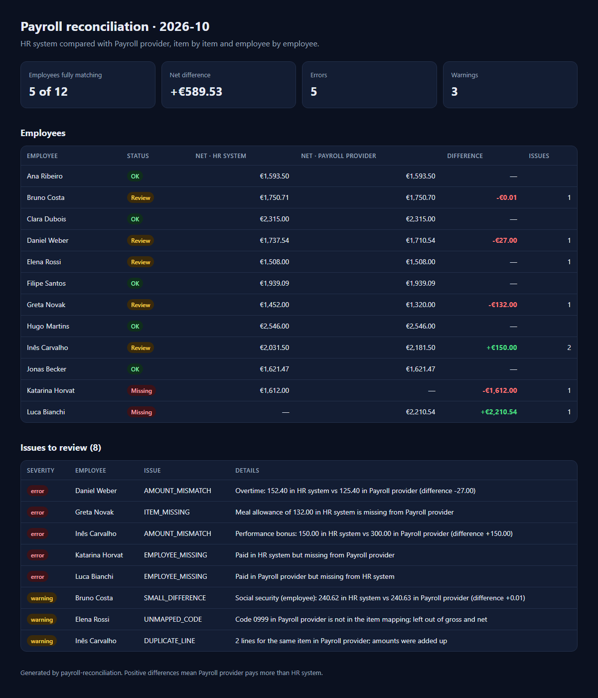

# Payroll Reconciliation

[](https://github.com/alelexand/payroll-reconciliation/actions/workflows/tests.yml)


Compares two payroll exports for the same month, such as the **company's HR system** and the **payroll provider or accounting firm**, **item by item and employee by employee**, and lists every discrepancy **before salaries are paid**.

Each month someone usually puts both files side by side in a spreadsheet and hunts for differences by eye. This tool does that in a second, even when the two systems use different item codes, column names and number formats.



> All names and amounts in this repository are fictional and generated by `payroll_check/sample.py`.

## What it finds

| Issue | Severity | Example |
|---|---|---|
| `EMPLOYEE_MISSING` | error | A new hire was never sent to the provider, or a leaver is still being paid |
| `ITEM_MISSING` | error | The meal allowance exists on one side only |
| `AMOUNT_MISMATCH` | error | Overtime typed as 125.40 instead of 152.40 |
| `SMALL_DIFFERENCE` | warning | A 0.01 rounding difference in social security (threshold configurable) |
| `DUPLICATE_LINE` | warning | The same bonus entered twice. The amounts are added up and flagged. |
| `UNMAPPED_CODE` | warning | An item code that is not in the mapping. It is left out of gross and net. |

For each employee it also shows **gross, deductions and net on both sides** and the difference between them.

## Highlights

- **Different item codes on each side.** A small mapping file says that `120` in one system and `0200` in the other are both *Overtime*.
- **Different file layouts.** Columns such as `employee_id` / `Worker ID` / `emp_id` and `amount` / `Value` are recognised automatically. Both CSV (comma or semicolon) and Excel are accepted.
- **European and English number formats**, like `1.234,56`, `1,234.56` and `€ 1 234,50`.
- **Exact money arithmetic.** It uses `Decimal`, never floating point, so cents never drift.

## Quick start

```bash
git clone https://github.com/alelexand/payroll-reconciliation.git
cd payroll-reconciliation
python -m venv .venv
# Windows: .venv\Scripts\activate   ·   macOS/Linux: source .venv/bin/activate
pip install -r requirements.txt

python -m payroll_check sample --out sample_data
python -m payroll_check compare --a sample_data/hr_system.csv --b sample_data/payroll_provider.csv \
                                --items sample_data/items.csv --period 2026-10
```

```
  Employee          Status       Net HR system   Net Payroll p   Difference
  Ana Ribeiro       ok               €1,593.50       €1,593.50
  Bruno Costa       review           €1,750.71       €1,750.70       -€0.01
  Daniel Weber      review           €1,737.54       €1,710.54      -€27.00
  Katarina Horvat   missing          €1,612.00               -   -€1,612.00
  ...
  5 error(s), 3 warning(s)
```

The sample files show the problem this solves: `hr_system.csv` is comma-separated with amounts like `1850.00`, and `payroll_provider.csv` is semicolon-separated, with other column names, other item codes and amounts like `1.850,00`.

## Using your own data

**Payroll exports** (one row per employee and item):

| employee_id | employee_name *(optional)* | item_code | amount |
|---|---|---|---|
| E001 | Ana Ribeiro | 100 | 1850.00 |

**Item mapping** (optional; without it, item codes must be identical on both sides):

| key | name | type | code_a | code_b |
|---|---|---|---|---|
| OVERTIME | Overtime | earning | 120 | 0200 |
| TAX | Income tax withholding | deduction | 510 | 9020 |

Options:

```bash
python -m payroll_check compare --a hr.xlsx --b provider.csv --items items.csv \
    --label-a "HR system" --label-b "Accounting firm" --period 2026-10 \
    --tolerance 0.00 --small-difference 1.00 --out reports --strict
```

- `--tolerance`: differences up to this value are treated as equal (default `0.00`).
- `--small-difference`: differences up to this value are warnings instead of errors (default `1.00`).
- `--strict`: exit code `1` when there are errors, for scheduled jobs and CI.

## Output

- **Excel** with three sheets: *Summary* (gross, deductions and net on both sides, plus totals), *Issues* (colour-coded) and *Items* (every item for every employee, with the difference).
- **HTML**: one self-contained file that works on mobile and in dark mode.

## Project structure

```
payroll_check/
├── engine.py         # matching and rules (no I/O, fully unit-tested)
├── money.py          # Decimal parsing/formatting for European and English formats
├── io.py             # CSV/Excel reading, column aliases, validation
├── report_excel.py   # Excel report (openpyxl)
├── report_html.py    # HTML report
├── sample.py         # two fictional, slightly different payroll exports
└── cli.py            # command line
tests/                # 37 tests (pytest)
```

## Tests

```bash
pip install pytest
pytest
```

## License

MIT. Built by [Alexandre Lasse](https://alelexand.github.io), freelance developer of automation and custom software for SMEs. Need something like this for your company? [Get in touch](https://alelexand.github.io/#contact).
